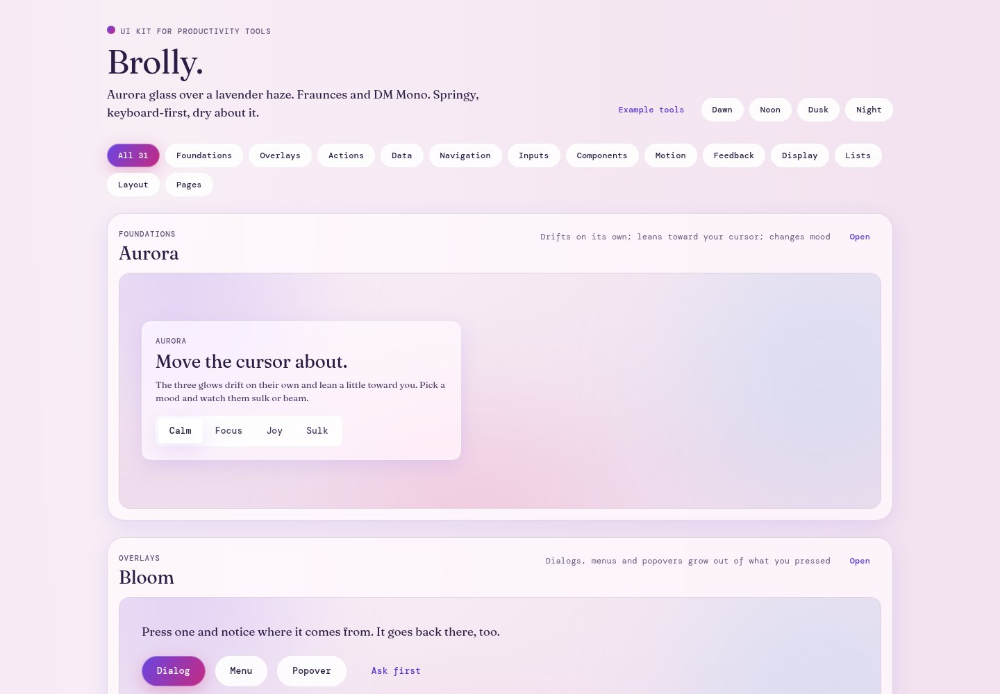

# Brolly

A UI kit for productivity tools, built with plain CSS and JavaScript. Aurora glass over a lavender haze, Fraunces and DM Mono, springy motion, and a keyboard-first way of working.



## Features

- **29 components** — buttons, fields, date fields, controls, tabs, rows, drag/reorder, lasso selection, command bar, hint overlay, toasts, dialogs, menus, charts, progress, empty states, a navigation rail, a bento layout, and more.
- **No runtime dependencies** — two files: `dist/brolly.css` and `dist/brolly.js`.
- **Four themes** — `dawn`, `noon`, `dusk`, `night`, all driven by CSS custom properties.
- **Override-friendly CSS** — styles live in named `@layer`s, so application CSS wins without specificity fights.
- **Hackable behaviour** — plain DOM, `data-br` attributes, bubbling `br-*` events, and a small `Brolly` API.
- **44 hairline icons**, self-hosted fonts, reduced-motion support, and visible focus states.
- **Eight complete example tools**, each a standalone page.

## Quick start

```html
<link rel="stylesheet" href="dist/brolly.css">
<script src="dist/brolly.js"></script>

<div class="br-stage" data-theme="dawn">
  <button class="br-btn br-btn--primary">Add a task</button>
</div>

<script>
  Brolly.init();
</script>
```

ES modules are available too:

```js
import Brolly from './dist/brolly.esm.js';
```

## Themes

Set `data-theme` on any wrapper, or let the kit follow the clock:

```html
<div class="br-stage" data-theme="night">…</div>
```

```js
Brolly.sun.start();        // dawn / noon / dusk / night, by local hour
Brolly.sun.set('dusk');    // or pin one
```

All components read tokens (`--canvas`, `--glass`, `--ink`, `--accent`, …), so a theme change needs no component changes.

## Examples

Each example is a working productivity tool showing a different slice of the kit. Open `examples/index.html`, or run `npm run preview` and visit `/examples/`.

| Example | What it exercises |
| --- | --- |
| [`examples/tasks/`](examples/tasks/) | rail, rows, drag reorder, lasso, command bar, chart, progress, date field, dialogs, toasts |
| [`examples/notes/`](examples/notes/) | sidebar list, autosave, search, word count, delete confirmation, empty states |
| [`examples/habits/`](examples/habits/) | week grid, streak maths, progress ring, chart, add/remove |
| [`examples/focus/`](examples/focus/) | large ring timer, start/pause/reset, tabs, sound, session log, chart |
| [`examples/library/`](examples/library/) | read-later cards, filters, search, add dialog with validation, read/unread |
| [`examples/expenses/`](examples/expenses/) | forms, validation, natural-language dates, period tabs, table, chart, totals |
| [`examples/journal/`](examples/journal/) | date navigation, mood radios, prompts, autosave, search, delete |
| [`examples/flashcards/`](examples/flashcards/) | decks, reveal, keyboard grading, deck progress, chart |

The examples share only `examples/_shared.css` and `examples/_shared.js` (local storage, dates, theme cycling), so each page can be lifted out and edited in isolation. `examples/tasks/` is generated from `design/previews/Showcase/preview.html` by the build; the other seven are hand-written.

## Structure

```
src/css/             fonts, tokens, base styles, one file per component group
src/js/components/   core plus one file per component, concatenated in order
design/              component previews, component notes, design guides, token metadata
build.mjs            concatenates src → dist and regenerates docs previews
dist/                brolly.css, brolly.js, brolly.esm.js, fonts, components.json
docs/                standalone component gallery and generated previews
examples/            eight example tools plus the index
tests/               Playwright smoke, interaction, ESM and example checks
```

## Development

```bash
npm run build      # dist + docs previews + examples/tasks
npm run preview    # http://localhost:4173/docs/  (examples at /examples/)
npm test           # previews, interactions, ESM and all examples
```

The test suite needs Python 3 with Playwright. Set `BROLLY_CHROMIUM` if Chromium is not discoverable.

`build.mjs` has no runtime dependencies and only uses Node's standard library.

## Customising

**Tokens.** Override any custom property on `.br-stage` or `:root`.

```css
.br-stage {
  --accent: #0b6f63;
  --grad-start: #0b6f63;
  --grad-end: #1c80c6;
}
```

**Component styles.** App CSS is unlayered, so it wins over `@layer brolly.*` without extra specificity.

```css
.br-btn--primary {
  letter-spacing: 0.02em;
}
```

**Behaviour.** `Brolly.init()` wires anything with a `data-br` hook (`tabs`, `sortable`, `lasso`, `orb`, `date`, …). Components emit bubbling custom events such as `br-tab`, `br-date`, `br-reorder`, and `br-bulk`.

**Source.** Edit `src/`, then run `npm run build`. Don't edit `dist/` or the generated previews by hand.

## Accessibility and motion

Components use native controls where possible, visible focus rings, text labels alongside colour, keyboard support, and `prefers-reduced-motion` handling. Fonts are self-hosted with `font-display: swap`.

The full notes live in [`design/guides/accessibility.md`](design/guides/accessibility.md), with behaviour, motion, and copy guidance alongside it.

## Browser support

Modern browsers with `@layer`, `color-mix()`, and `backdrop-filter` support. The visual design degrades gracefully to plain rounded corners and solid surfaces where advanced CSS is unavailable.

## License

MIT. See [LICENSE](LICENSE).
